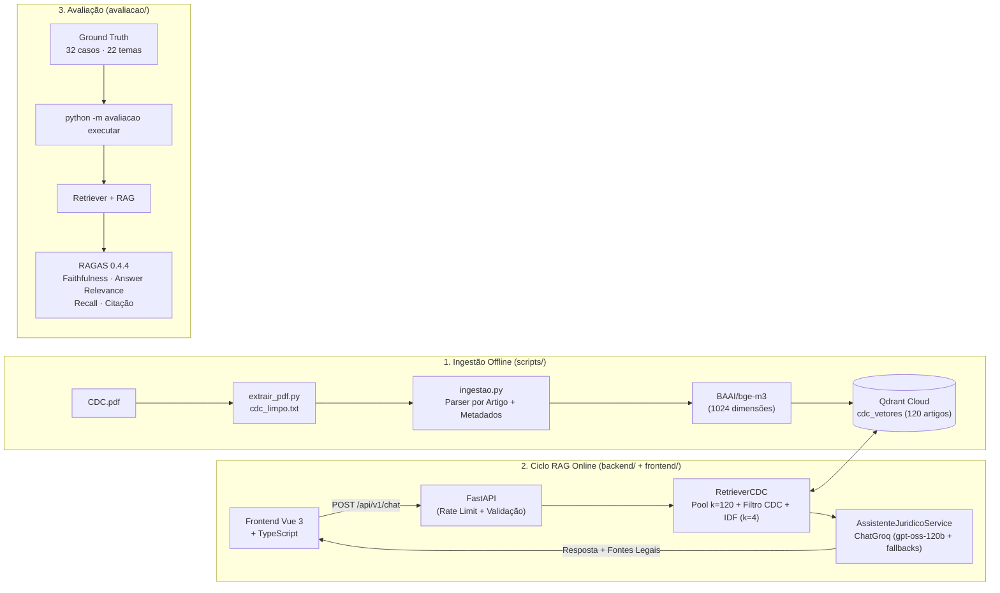

# Assistente Jurídico CDC

Assistente de perguntas e respostas baseado em **RAG (Retrieval-Augmented Generation)** especializado exclusivamente no **Código de Defesa do Consumidor (Lei nº 8.078/1990)**. O projeto combina ingestão estruturada da legislação por artigo, recuperação híbrida em banco vetorial, geração de respostas estritamente fundamentadas no contexto legal recuperado, interface web em Vue 3 e suíte automatizada de avaliação com RAGAS.

> [!NOTE]
> Este projeto tem caráter informativo e acadêmico. As respostas geradas apoiam a consulta ao texto do Código de Defesa do Consumidor e **não substituem orientação jurídica profissional**.

## Documentação Complementar

- **Backend (API e Pipeline RAG):** [backend/README.md](backend/README.md)
- **Frontend (Interface Web):** [frontend/README.md](frontend/README.md)
- **Avaliação Automatizada (RAGAS e Ground Truth):** [avaliacao/README.md](avaliacao/README.md)
- **Registro Técnico da Sprint 2:** [docs/sprint-2-backend-api.md](docs/sprint-2-backend-api.md)
- **Wiki do Projeto:** [Wiki no GitHub](https://github.com/leofevife/assistente-juridico-pi4/wiki)

---

## Arquitetura do Sistema

O fluxo é dividido em três camadas principais: **ingestão offline**, **atendimento online (API + Frontend)** e **avaliação contínua**.



---

## Stack Tecnológica

| Camada | Tecnologias |
| :--- | :--- |
| **Frontend** | Vue 3 (`<script setup lang="ts">`), TypeScript 5.8, Vite 7, `marked`, `DOMPurify`, `@fontsource` (Newsreader, Instrument Sans, IBM Plex Mono) |
| **Backend / API** | Python, FastAPI, Uvicorn, Pydantic v2 (`pydantic-settings`), Rate Limiting por IP |
| **Orquestração RAG & LLM** | LangChain (`langchain-core`, `langchain-groq`), `ChatGroq` (`openai/gpt-oss-120b` com fallbacks para `openai/gpt-oss-20b` e `qwen/qwen3.8-27b`) |
| **Embeddings & Banco Vetorial** | `BAAI/bge-m3` (1024 dimensões) via `HuggingFaceEndpointEmbeddings` (`hf-inference` HTTP em produção) ou `HuggingFaceEmbeddings` local (`sentence-transformers`), Qdrant Cloud (`langchain-qdrant`, `qdrant-client`) |
| **Ingestão de Dados** | `pdfplumber` e expressões regulares em Python com preservação de `Título`, `Capítulo`, `Seção` e `Artigo` |
| **Testes & Avaliação** | `pytest` + `httpx` (70 testes Python), Vitest + `@vue/test-utils` + `jsdom` (32 testes frontend), `ragas==0.4.4` |

---

## Estrutura do Repositório

```text
assistente-juridico/
├── backend/                     # API FastAPI, configurações, retriever híbrido e serviço RAG
│   ├── api/                     # Rotas (/api/v1/health, /api/v1/ready, /api/v1/chat), schemas e dependências
│   ├── core/                    # Configurações (.env), logging estruturado e rate limiter por IP
│   ├── data/                    # CDCVectorRepository e RetrieverCDC (busca densa + filtro + IDF)
│   ├── services/                # AssistenteJuridicoService, prompt jurídico e cadeia LangChain + fallbacks
│   ├── tests/                   # Testes unitários e de integração da API
│   ├── .env.example             # Modelo de variáveis de ambiente do backend
│   ├── main.py                  # Ponto de entrada FastAPI (lifespan, CORS e tratamento global de erros)
│   └── README.md                # Guia detalhado do backend
├── frontend/                    # Interface web em Vue 3 + TypeScript + Vite
│   ├── src/                     # Componentes, cliente HTTP, renderização segura de Markdown e testes
│   ├── .env.example             # Configuração opcional de URL da API e proxy do Vite
│   └── README.md                # Guia detalhado do frontend
├── avaliacao/                   # CLI de avaliação com Ground Truth e RAGAS
│   ├── dados/                   # ground_truth.json (32 casos em 22 temas do CDC)
│   ├── resultados/              # Relatórios executados (baseline e pos-ajuste)
│   ├── tests/                   # Testes da suíte de avaliação
│   └── README.md                # Guia completo das métricas e decisões de ajuste
├── scripts/                     # Scripts offline de extração do PDF e ingestão vetorial
│   ├── resources/               # CDC.pdf e texto limpo extraído (cdc_limpo.txt)
│   ├── extrair_pdf.py           # Extração e limpeza de quebras de linha do PDF oficial
│   └── ingestao.py              # Parser estruturado por artigo, embedding e carga no Qdrant
├── docs/                        # Documentação técnica versionada
├── pytest.ini                   # Configuração do pytest (backend/tests e avaliacao/tests)
├── requirements.txt             # Dependências enxutas de produção da API (embeddings via endpoint HTTP)
├── requirements-dev.txt         # Dependências completas (ingestão, embeddings locais, testes e RAGAS)
└── README.md                    # Visão geral do repositório
```

---

## Como Executar Localmente

### Pré-requisitos

- **Python** (recomendado 3.11+ com ambiente virtual)
- **Node.js** e **npm**
- Conta e cluster no **Qdrant Cloud** (`QDRANT_URL` e `QDRANT_API_KEY`)
- Chave de API da **Groq** (`GROQ_API_KEY`)

### 1. Instalar dependências Python

Na raiz do repositório (`assistente-juridico/`):

```bash
# Ambiente completo (backend, embeddings locais, ingestão, testes e avaliação RAGAS)
pip install -r requirements-dev.txt
```

> [!TIP]
> Para instalar apenas as dependências **enxutas de execução da API em produção** (sem `sentence-transformers`/`torch` nem `pdfplumber`, usando o endpoint HTTP da Hugging Face com `HF_API_TOKEN`), utilize `pip install -r requirements.txt`. No Windows com Python 3.14, caso alguma subdependência de `ragas==0.4.4` apresente incompatibilidade de instalação, consulte a instrução específica em [avaliacao/README.md](avaliacao/README.md).

### 2. Configurar variáveis de ambiente

Copie [backend/.env.example](backend/.env.example) para `backend/.env` e preencha suas credenciais:

```bash
cp backend/.env.example backend/.env
```

Principais variáveis disponíveis em `backend/.env`:

| Variável | Descrição | Valor padrão no exemplo |
| :--- | :--- | :--- |
| `QDRANT_URL` | URL do cluster Qdrant | *(obrigatório)* |
| `QDRANT_API_KEY` | Chave de acesso ao Qdrant | *(obrigatório)* |
| `QDRANT_COLECAO` | Nome da coleção vetorial | `cdc_vetores` |
| `GROQ_API_KEY` | Chave da API Groq | *(obrigatório)* |
| `GROQ_MODELO` | Modelo principal de geração | `openai/gpt-oss-120b` |
| `MODELO_EMBEDDING` | Modelo de embedding (HuggingFace) | `BAAI/bge-m3` |
| `EMBEDDING_PROVEDOR` | Modo do embedding: `auto`, `api` (`hf-inference`) ou `local` | `auto` |
| `HF_API_TOKEN` | Token da Hugging Face (opcional; ativa endpoint HTTP no modo `auto` e obrigatório em `api`) | *(vazio)* |
| `RETRIEVER_K` | Quantidade de trechos no contexto final | `4` |
| `CORS_ORIGENS` | Origens permitidas no CORS | `http://localhost:5173,http://localhost:3000` |
| `RATE_LIMIT_REQUISICOES` | Máximo de requisições por janela/IP | `20` |
| `RATE_LIMIT_JANELA_SEGUNDOS` | Duração da janela do rate limit | `60` |

### 3. (Opcional) Ingestão da base vetorial

Se precisar recriar ou popular a coleção `cdc_vetores` no Qdrant a partir de [scripts/resources/CDC.pdf](scripts/resources/CDC.pdf):

```bash
python scripts/extrair_pdf.py
python scripts/ingestao.py
```

O pipeline de ingestão extrai **120 artigos** da Lei nº 8.078/1990, anexa metadados hierárquicos (`lei`, `titulo`, `capitulo`, `secao`, `artigo`), gera vetores de **1024 dimensões** com `BAAI/bge-m3` e envia em lotes para o Qdrant Cloud.

### 4. Iniciar o Backend

Execute a partir da **raiz do repositório** para manter o pacote `backend` no `PYTHONPATH`:

```bash
python -m uvicorn backend.main:app --reload
```

- API local: `http://localhost:8000`
- Documentação Swagger UI: `http://localhost:8000/docs`
- Endpoints disponíveis:
  - `GET /api/v1/health` — verificação básica de disponibilidade e versão
  - `GET /api/v1/ready` — verificação de conectividade com a coleção no Qdrant
  - `POST /api/v1/chat` — envio de dúvida e retorno da resposta com fontes legais

### 5. Iniciar o Frontend

Em outro terminal:

```bash
cd frontend
npm install
npm run dev
```

- Interface web: `http://localhost:5173`
- Em desenvolvimento, o Vite faz proxy automático das chamadas de API para `http://localhost:8000` (configurável em [frontend/.env.example](frontend/.env.example)).

---

## Testes Automatizados

### Backend e Avaliação (`pytest`)

Na raiz do repositório:

```bash
python -m pytest
```

Cobre **70 testes** distribuídos entre `backend/tests` (API, validações Pydantic, seleção de provedor de embedding, rate limit e serviço RAG com doubles de teste) e `avaliacao/tests` (validação do Ground Truth, métricas e relatórios).

### Frontend (`Vitest`)

Dentro de `frontend/`:

```bash
npm test
npm run typecheck
npm run build
```

Cobre **32 testes** de unidade e componentes com Vitest, `@vue/test-utils` e `jsdom`.

---

## Avaliação da Qualidade RAG (RAGAS)

A pasta [avaliacao/](avaliacao/README.md) implementa um pipeline completo de avaliação sobre **32 casos** distribuídos em **22 temas** do CDC (`avaliacao/dados/ground_truth.json`).

Comandos principais na raiz do projeto:

```bash
python -m avaliacao validar
python -m avaliacao executar --rotulo minha-execucao
```

### Evolução dos Resultados (Baseline vs. Pós-Ajuste)

Após a análise dos gargalos iniciais no `baseline`, o sistema recebeu recuperação híbrida no `RetrieverCDC` (pool `k=120`, filtragem defensiva de normas acessórias e reordenação complementar ponderada por IDF) e refinamento do prompt e fallback entre modelos no `AssistenteJuridicoService`.

| Indicador | Meta | Baseline | Pós-Ajuste | Situação |
| :--- | :---: | :---: | :---: | :--- |
| **Faithfulness** (fidelidade ao contexto) | `> 0,850` | `0,911` | **`0,884`** | Atingida (`32/32` perguntas avaliadas) |
| **Answer Relevance** (relevância da resposta) | `> 0,800` | `0,773` | **`0,807`** | Atingida (`32/32` perguntas avaliadas) |
| **Recall dos artigos de referência** | — | `0,922` | **`0,969`** | `30/32` casos com recall `1,000` |
| **Citação dos artigos de referência** | — | `0,922` | **`0,938`** | Elevada precisão na citação de artigos |

Os relatórios detalhados de cada rodada estão versionados em [avaliacao/resultados/baseline/relatorio.md](avaliacao/resultados/baseline/relatorio.md) e [avaliacao/resultados/pos-ajuste/relatorio.md](avaliacao/resultados/pos-ajuste/relatorio.md).
