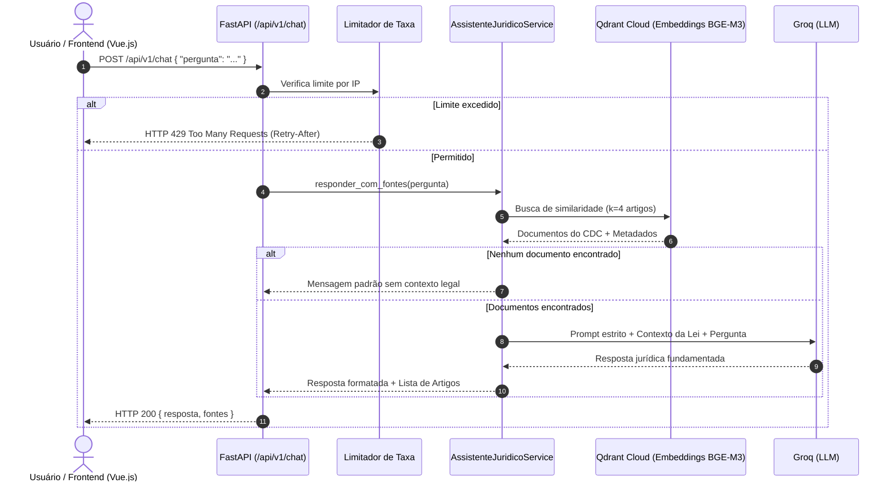

# Sprint 2: Desenvolvimento do Backend (API) e Pipeline RAG

Documentação técnica da Sprint 2 do **Projeto Integrador 4: Assistente de Inteligência Jurídica** (FAESA).

---

## 1. Visão Geral e Objetivos da Sprint

A **Sprint 2** teve como objetivo central transformar os componentes de dados gerados na Sprint 1 (base vetorial do Código de Defesa do Consumidor indexada no Qdrant) em uma API de serviços robusta, segura e escalável, preparando o ecossistema para a integração com a interface web (Sprint 3) e para a avaliação quantitativa via RAGAS (Sprint 4).

### Entregáveis Chave Concluídos
- Estruturação arquitetural em camadas (`api`, `core`, `services`, `data`).
- Configuração do servidor **FastAPI** com ciclo de vida gerenciado (`lifespan`).
- Implementação dos endpoints de chat (`/api/v1/chat`), liveness (`/api/v1/health`) e readiness (`/api/v1/ready`).
- Orquestração do pipeline RAG utilizando **LangChain** (LCEL) com devolução de fontes citadas.
- Mecanismos de segurança: rate limiting, CORS restrito, cabeçalhos HTTP defensivos e higienização de entradas.
- Cobertura de testes automatizados com mocks (30 testes unitários e de integração com **pytest**).

---

## 2. Tecnologias Utilizadas e Justificativas

| Tecnologia | Função no Projeto | Justificativa Técnica |
|---|---|---|
| **Python 3.14** | Linguagem principal | Ecossistema padrão da indústria para Inteligência Artificial, manipulação de texto e orquestração de LLMs. |
| **FastAPI** | Framework Web / API | Alta performance assíncrona (ASGI), tipagem estrita com Pydantic, geração automática de documentação interativa (Swagger UI / OpenAPI) e facilidade de injeção de dependências. |
| **Uvicorn** | Servidor ASGI | Servidor de produção leve e rápido para aplicações assíncronas em Python. |
| **LangChain (LCEL)** | Orquestrador RAG | Permite construir cadeias declarativas, modulares e assíncronas (*LangChain Expression Language*), desacoplando a recuperação documental da chamada ao modelo de linguagem. |
| **Groq API (`ChatGroq`)** | Provedor de Inferência LLM | Processamento de inferência em chips LPU (*Language Processing Units*), proporcionando baixíssima latência na geração de respostas jurídicas. |
| **Qdrant Cloud** | Banco de Dados Vetorial | Banco de vetores especializado em busca aproximada por similaridade de cosseno (HNSW), com suporte nativo a filtros por metadados (Título, Capítulo, Seção, Artigo). |
| **BAAI/bge-m3** | Modelo de Embedding | Modelo multilíngue de alta capacidade (1024 dimensões) com comprovada eficácia para tarefas de recuperação semântica em língua portuguesa. |
| **Pydantic & Pydantic Settings** | Validação e Configuração | Validação em tempo de execução dos dados recebidos do cliente e mascaramento seguro de credenciais sensíveis via `SecretStr`. |
| **Pytest & HTTPX** | Testes Automatizados | Execução de testes de regressão rápidos e isolados (sem custos de API ou dependência de rede externa). |

---

## 3. O Que Foi Desenvolvido e Por Que Foi Feito

### 3.1. Arquitetura Modular em Camadas
O backend foi organizado em quatro módulos bem definidos:

```
backend/
├── api/          # Entrada HTTP, rotas, schemas Pydantic e dependências
├── core/         # Configurações globais, segurança, logs e rate limit
├── data/         # Acesso à infraestrutura de dados (Qdrant e Embeddings)
├── services/     # Regras de negócio e cadeia RAG (LangChain)
└── tests/        # Bateria de testes automatizados e scripts de teste
```

**Por que foi feito:**
Garante baixo acoplamento e alta coesão. A camada de API não precisa saber como o Qdrant funciona, e a camada de serviço pode ter seus componentes (LLM e Retriever) substituídos ou simulados em testes sem alterar as rotas HTTP.

---

### 3.2. Gerenciamento Centralizado de Configuração (`backend/core/config.py`)
- Mapeia variáveis de ambiente (`.env`) por meio do `pydantic-settings`.
- Campos confidenciais (`QDRANT_API_KEY`, `GROQ_API_KEY`) utilizam o tipo `SecretStr`, evitando vazamento acidental em logs ou exceções.
- Suporte flexível para origens permitidas de CORS (lista JSON ou texto separado por vírgula).
- Desativação automática da documentação Swagger (`/docs` e `/redoc`) quando em ambiente de produção (`AMBIENTE=producao`).

**Por que foi feito:**
Centraliza valores que mudam conforme o ambiente (desenvolvimento vs. produção) e atende aos princípios do *12-Factor App*.

---

### 3.3. Ciclo de Vida da Aplicação e Otimização de Recursos (`backend/main.py`)
- O carregamento do modelo de embedding `BAAI/bge-m3` e a inicialização do cliente Qdrant foram encapsulados no gerenciador de contexto `lifespan` do FastAPI.
- O serviço e o repositório são instanciados uma única vez na inicialização da aplicação e compartilhados no `app.state`.

**Por que foi feito:**
Modelos de embedding exigem leitura de pesos em disco e alocação de memória RAM. Se fossem inicializados a cada requisição, a API apresentaria latência proibitiva de dezenas de segundos por pergunta. O *lifespan* resolve isso mantendo a instância pronta na memória.

---

### 3.4. Rota de Chat e Resposta Estruturada com Fontes (`backend/api/routes/chat.py`)
- Rota: `POST /api/v1/chat`.
- Payload de entrada: `{"pergunta": "string"}`.
- Payload de saída:
  ```json
  {
    "resposta": "Texto da resposta fundamentada no CDC...",
    "fontes": [
      {
        "lei": "Lei 8.078/1990 (CDC)",
        "titulo": "Título I",
        "capitulo": "Capítulo VI",
        "secao": "Seção I",
        "artigo": "49",
        "trecho": "[...] Art. 49 O consumidor pode desistir do contrato..."
      }
    ]
  }
  ```

**Por que foi feito:**
Para viabilizar os requisitos da Sprint 3 (exibição interativa no Vue.js dos artigos citados como referência) e da Sprint 4 (cálculo de *Faithfulness* e *Answer Relevance* no RAGAS a partir do contexto real recuperado).

---

### 3.5. Segurança e Resiliência

1. **Limitador de Taxa de Requisições (`backend/core/rate_limit.py`):**
   - Implementado com algoritmo de janela deslizante assíncrona por IP.
   - Retorna código HTTP `429 Too Many Requests` e cabeçalho `Retry-After` quando o limite é excedido.
   - *Motivo:* Protege o servidor contra ataques de negação de serviço (DoS) e evita custos imprevistos na API da Groq.

2. **Defesas contra Injeção de Prompt no RAG (`backend/services/rag_service.py`):**
   - O prompt do sistema instrui explicitamente a ignorar instruções inseridas pelo usuário que tentem mudar o comportamento ou contornar as regras jurídicas.
   - O sistema responde com mensagem padronizada se o contexto recuperado for insuficiente para fundamentar a dúvida.

3. **Cabeçalhos de Segurança HTTP:**
   - Inclusão automática de `X-Content-Type-Options: nosniff`, `X-Frame-Options: DENY`, `Referrer-Policy: no-referrer` e `Cache-Control: no-store`.
   - *Motivo:* Prevenção contra ataques comuns de framing (clickjacking) e MIME-sniffing.

4. **Tratamento Global de Exceções:**
   - Erros inesperados são logados internamente com *stack trace*, mas a resposta ao cliente é genérica (`500 Internal Server Error`), impedindo vazamento de caminhos de arquivos ou chaves no corpo HTTP.

---

### 3.6. Monitoramento de Saúde (`backend/api/routes/saude.py`)
- `/api/v1/health`: Teste de liveness (confirma que o processo HTTP está ativo).
- `/api/v1/ready`: Teste de readiness (avalia ativamente se a coleção `cdc_vetores` do Qdrant está acessível; retorna `503 Service Unavailable` caso o banco vetorial esteja fora do ar).

**Por que foi feito:**
Permite que orquestradores de contêineres e balanceadores de carga saibam quando direcionar tráfego para a API sem matar o processo caso ocorra uma oscilação temporária na rede externa.

---

### 3.7. Suíte de Testes Automatizados (`backend/tests/`)
Foram desenvolvidos 30 testes automatizados cobrindo:
- Validação e parsing de esquemas de entrada (tamanho mínimo, máximo, rejeição de campos desconhecidos).
- Comportamento de bloqueio e liberação do limitador de taxa (janela temporal).
- Conformidade de CORS e cabeçalhos de segurança HTTP.
- Respostas do pipeline RAG, montagem do prompt e devolução correta das fontes.
- Isolamento semântico quando nenhum documento relevante é retornado.

**Por que foi feito:**
Garante a estabilidade da aplicação, viabiliza integração contínua (CI) e evita regressões conforme novas funcionalidades forem adicionadas.

---

## 4. Fluxo de Execução da Requisição (RAG)



---

## 5. Como Executar e Validar

### 5.1. Instalação das Dependências
```powershell
pip install -r requirements-dev.txt
```

### 5.2. Configuração do `.env`
Crie ou edite o arquivo `backend/.env` baseado no `backend/.env.example`:
```env
AMBIENTE=desenvolvimento
QDRANT_URL=https://seu-cluster.cloud.qdrant.io:6333
QDRANT_API_KEY=sua-chave-qdrant
QDRANT_COLECAO=cdc_vetores
GROQ_API_KEY=sua-chave-groq
GROQ_MODELO=openai/gpt-oss-120b
```

### 5.3. Execução dos Testes Automatizados
```powershell
python -m pytest
```

### 5.4. Inicialização do Servidor
```powershell
python backend/main.py
# ou via uvicorn:
python -m uvicorn backend.main:app --reload
```

Acesse a documentação interativa da API em: **http://localhost:8000/docs**

